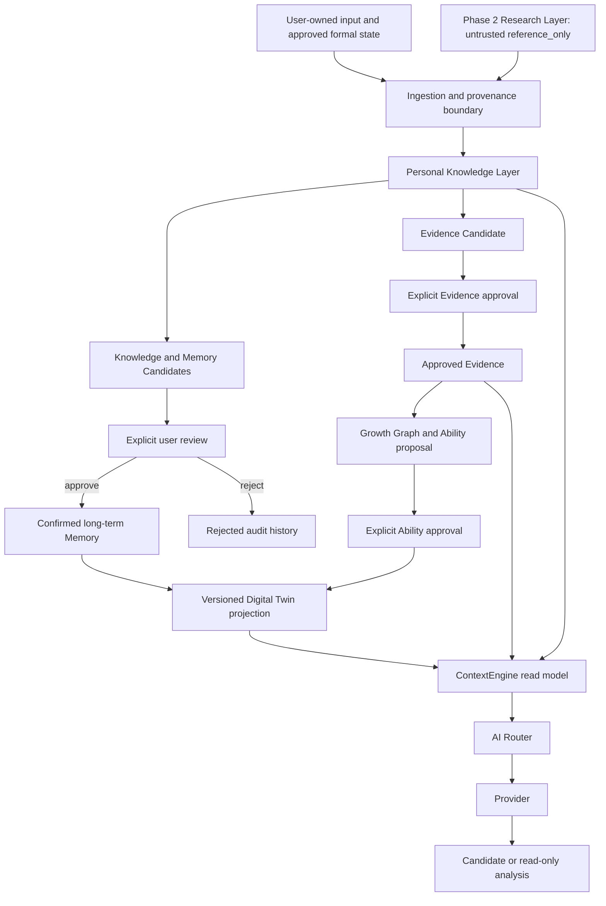
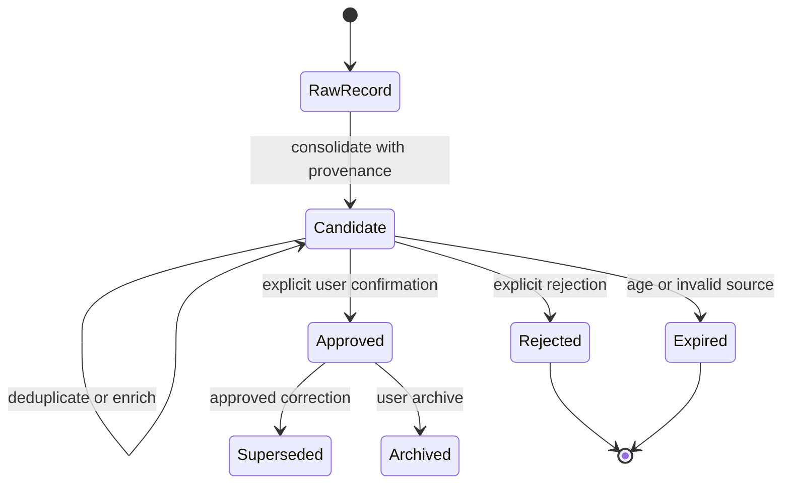
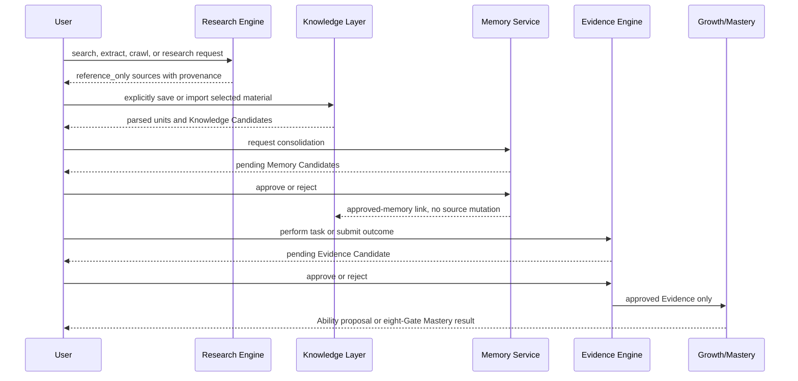
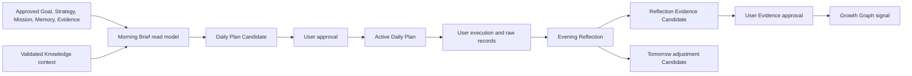

# Genesis OS Phase 3: Personal Knowledge & Intelligence Layer Architecture

Status: **architecture approved; Steps 1 through 10 implemented as separate owner-review checkpoints**

Phase 2 baseline: `main@9e41449126a4ba99efff0f6fbcd494b95354229f`

Implementation status: **Steps 1 through 10 foundations**. Step 5 aggregates Learning Material Candidates into Personal Learning Intelligence. Step 6 adds only Ability/Growth Candidates. Step 7 adds only Personal Digital Twin Candidates. Step 8 adds only Personal Decision Intelligence Candidates. Step 9 adds only Reflection and Mentor Intelligence Candidates. Step 10 adds only source-validated Mission Statement, Long-term Direction, Value Signal, Strategic Goal Direction, Life Strategy Reflection, Goal Alignment, and aggregate Candidates. No Phase 3 API, page, final Digital Twin, Decision, Reflection, Mentor, Mission, identity, Goal, or Strategy truth, Context injection, approval projection, or automatic formal-state update has started.

## 1. Purpose

Phase 3 will connect the existing Research, Knowledge, Memory, Context, Evidence, Growth, Learning, Mentor, Strategy, Mission, and Daily Loop capabilities into a coherent Personal Knowledge & Intelligence Layer. The layer must help Genesis understand what the user has encountered, what the user has explicitly accepted as durable memory, what the user can actually demonstrate, and what should be learned or done next.

This design is additive. It does not replace or simplify any existing Genesis OS product capability. Existing data, routes, approval history, local-single-user operation, and deterministic Mastery rules remain authoritative.

## 2. Non-negotiable constitutional boundaries

1. Research output is untrusted, `reference_only` material. A URL, snippet, provider report, or relevance score is not Knowledge, Memory, Evidence, Ability, or Mastery.
2. Knowledge ingestion must preserve provenance, ownership, content rights, parser state, and validation state.
3. Memory evolution must follow `raw input -> Memory Candidate -> explicit user confirmation -> active long-term memory`.
4. Rejected, expired, invalid, or pending candidates must not enter formal Context.
5. Evidence remains approval-gated. AI analysis may create an Evidence Candidate but may not approve it.
6. Formal Ability changes require approved Evidence, explicit user confirmation, an audit record, and the existing database guards.
7. Mastery remains governed by all eight deterministic Gates. Course completion, AI scores, confidence, or accumulated notes cannot substitute for a Gate.
8. No AI output may directly modify Goal, Strategy, Mission, Daily Plan, Memory, Evidence, Ability, Mastery, or the formal Digital Twin.
9. All AI work must use `ContextEngine -> AI Router -> Provider`; domain modules may not call providers directly.
10. Existing capabilities may only be increased, strengthened, repaired, or compatibly refactored. They cannot be removed to make Phase 3 simpler.

## 3. Current baseline versus Phase 3 design

### 3.1 Existing and authoritative

- Local personal database backed by SQLite and additive migrations through `0035`.
- User-owned Knowledge records with SQLite FTS5 search.
- Approval-gated Memory Candidates and confirmed `user_memory_profile` records.
- Layered ContextEngine packets, source IDs, compression, and prompt-injection boundaries.
- Evidence Candidate approval, audit, Growth Graph, and formal Ability change guards.
- Learning goals, resources, curriculum, assessments, delayed review, project challenge, and Mastery Truth Contract.
- ResearchProvider abstraction and Tavily search, extract, crawl, and research operations.
- AI Router, provider adapters, provider logs, fallback, retry, and timeout handling.
- Mentor, Strategy, Mission, Daily Plan, Morning Brief, Evening Reflection, proactive insight, and monthly review loops.
- Thinking, Reading, Business, and Movie product regions already protected by the Capability Constitution.

### 3.2 Proposed, not implemented by this document

- A normalized knowledge-object lifecycle above existing raw Knowledge items.
- Explicit links among Research sources, user material, knowledge claims, memories, Evidence, abilities, and learning plans.
- A versioned, multidimensional Digital Twin projection built only from approved facts.
- Material analysis and mastery-time estimate contracts that distinguish estimates from verified outcomes.
- A unified retrieval policy for Learning, Mentor, Strategy, Daily Loop, Reading, Business, and Movie consumers.
- Governance rules for freshness, contradiction, supersession, duplication, and deletion.

### 3.3 Step 1 implementation

Phase 3 Step 1 adds `lib/domain/knowledge-truth.ts` and `lib/services/knowledge-truth-read-service.ts`:

- Zod contracts enforce the four truth classes and their permitted lifecycle, approval, provenance, and Context eligibility combinations.
- The read model maps completed Research sources to `reference_context` and preserves the database source ID.
- Existing `knowledge_items` remain unchanged and map to user-owned `untrusted_context` records.
- Memory Candidates remain visible in an excluded audit/read partition regardless of pending, approved, or rejected status.
- Only active Memory rows joined to an approved source Candidate map to `confirmed_personal_fact` and `formal_context`.
- Provider relevance remains a ranking score and is never represented as truth confidence.
- Demonstrated-capability projection is intentionally empty in Step 1. Existing Evidence, Growth Graph, and Mastery services remain authoritative and unchanged.
- The service has no mutation method, does not call ContextEngine or AI Router, and does not write an audit record merely by reading.

Step 1 introduces no migration, route, UI, ContextEngine injection, or new formal state.

### 3.4 Step 2 implementation

Phase 3 Step 2 adds migration `0036_personal_knowledge_layer.sql`, `lib/domain/personal-knowledge.ts`, and `lib/services/personal-knowledge-service.ts`:

- `knowledge_objects` owns the shared user, idempotency, creator, validation, approval, archive, and timestamp lifecycle.
- `knowledge_sources` supports uploaded files, books, PDFs, courses, videos, URLs, GitHub repositories, papers, and user notes while retaining ownership, original locator, legacy Knowledge IDs, Research source IDs, and provenance JSON.
- `knowledge_artifacts` stores parsed/raw references, extraction status, parser name/version/metadata, content hash, and source relationship.
- `knowledge_units` stores sections, concepts, claims, notes, and code regions with source/artifact/parent provenance.
- `knowledge_relations` supports `supports`, `contradicts`, `cites`, `supersedes`, and `derived_from` edges.
- `knowledge_collections` and `knowledge_collection_members` group sources, artifacts, and units for learning goals, books, courses, projects, and business cases.
- AI-created objects can only be inserted as pending Candidates. A terminal decision requires an explicit persisted approval decision, respects dependency order, and cannot be repeated.
- Existing `knowledge_items` is not altered or backfilled. An optional source link preserves compatibility without changing the legacy row.
- Data portability restores approval-gated Knowledge in dependency order rather than bypassing the database guards.

Step 2 does not expose the foundation through a new API or Context packet and does not call AI. Step 3 normalization has not started.

## 4. Target logical architecture

The architecture separates four kinds of truth:

| Truth class | Meaning | Promotion rule |
| --- | --- | --- |
| Reference | External or imported material that may be useful | Never promoted automatically |
| User record | Something the user wrote, uploaded, or explicitly saved | Retains ownership and provenance; not automatically a stable fact |
| Confirmed personal fact | A user-approved Memory/Profile fact | Candidate approval plus version and audit |
| Demonstrated capability | A claim supported by approved Evidence or deterministic Mastery Gates | Existing Evidence, Ability, and Mastery guards only |

## 5. Personal Knowledge Layer

### 5.1 Responsibilities

The Personal Knowledge Layer should organize user-owned notes and lawful source material without claiming that stored information is true, remembered, or mastered. It is responsible for:

- ingestion provenance and ownership;
- source and document identity;
- structural analysis of books, PDFs, notes, official documentation, courses, code, and authorized media transcripts;
- claim and concept extraction as candidates;
- duplicate and near-duplicate detection;
- source freshness and supersession links;
- retrieval ranking and context budgeting;
- explicit handoff to Memory, Evidence, Learning, and domain modules;
- deletion propagation and auditability.

### 5.2 Proposed logical objects

These are design-level objects, not approved database tables yet:

| Object | Purpose | Formal status |
| --- | --- | --- |
| `KnowledgeSource` | Identifies user input, upload, URL, Research run, book, course, repository, or reflection | Provenance only |
| `KnowledgeArtifact` | Stores or references the legally available content and parser result | User-owned/reference data |
| `KnowledgeUnit` | Addressable section, note, code region, concept, or claim | Candidate/index unit |
| `KnowledgeRelation` | Typed link such as supports, contradicts, cites, supersedes, applies-to, or derived-from | Validated relation |
| `KnowledgeCollection` | User-controlled grouping for a goal, project, book, course, business case, or movie | Organizational state |
| `KnowledgeCandidate` | Proposed normalized knowledge created from raw material | Pending until reviewed when promotion matters |
| `RetrievalTrace` | Records why a unit was selected for Context without storing private prompts | Operational audit only |

### 5.3 Provenance contract

Every retrievable unit must retain:

- stable source ID and parent artifact ID;
- source kind and ownership class;
- original locator such as URL, file name, chapter, timestamp, or repository path when available;
- ingestion and last-validated timestamps;
- parser/provider/version identity;
- content hash and deduplication key;
- confidence and validation status;
- citation-safe excerpt or an explicit `summary_only` marker;
- access/deletion state;
- links to the Research run or user action that created it.

Provider relevance is ranking metadata, not a truth score. AI summaries must never invent page numbers, chapters, quotations, code behavior, or source authorship.

### 5.4 Retrieval policy

Retrieval should be deterministic before optional AI reranking. The candidate set should consider:

`permission -> formal status -> source validity -> semantic/text relevance -> recency -> importance -> confidence -> diversity -> context budget`

The retrieval response must expose source IDs, reason codes, and truncation state. Consumers may request different policies, but cannot bypass formal-state filters. Memory and Digital Twin retrieval must default to approved records only. Research retrieval must remain visibly labeled as reference material.

## 6. User Digital Twin architecture

### 6.1 Definition

The Digital Twin is a versioned read model of confirmed user state, not an AI-authored biography. It projects existing authoritative records into a coherent context while preserving uncertainty, provenance, time, and user control.

### 6.2 Required dimensions

| Dimension | Examples | Authoritative source |
| --- | --- | --- |
| Identity and life context | stage, roles, constraints, timeline | approved Profile facts and user inputs |
| Goals and direction | long-term goals, current priorities | formal Goal and approved Strategy |
| Ability | demonstrated technical, cognitive, execution capabilities | approved Evidence, Growth Graph, Mastery |
| Learning | goals, materials, curriculum, assessments, recall state | Learning Engine and Mastery records |
| Projects and execution | projects, Missions, plans, outcomes, blockers | Mission, Daily Loop, Project Challenge |
| Knowledge and interests | confirmed themes, collections, source history | Knowledge plus approved Memory |
| Preferences and patterns | stable preferences and learning patterns | approved Memory Profile only |
| Decisions and strategy | simulations, choices, feedback, changes | approved Strategy and audit history |
| Reflection and wellbeing | user-recorded reflection and energy context | user-owned Daily Life records, never inferred as diagnosis |
| Provenance and uncertainty | source, confidence, freshness, contradiction | audit and source metadata |

### 6.3 Projection rules

- The Twin is derived; source repositories remain authoritative.
- Each field carries `source_ids`, `as_of`, `confidence`, `status`, and `version`.
- Conflicting facts coexist until resolved; the system must not silently overwrite history.
- Time-sensitive facts expire or become stale without being deleted.
- User correction creates a new version and supersession link.
- Sensitive dimensions use least-privilege retrieval and local-first storage.
- AI may propose a Twin Candidate, but only existing approval services may promote formal state.

## 7. Memory evolution architecture

### 7.1 Memory classes

- Episodic: dated user experiences and reflections.
- Semantic personal: confirmed stable facts, goals, preferences, and patterns.
- Procedural: confirmed ways the user works or learns.
- Project: durable project direction, constraints, and decisions.
- Capability: only carefully worded traits supported by approved Evidence; never a substitute for formal Ability.

### 7.2 Consolidation rules

1. Raw Knowledge and reflections remain immutable source records.
2. Consolidation groups repeated signals but cites every source ID.
3. Exact and semantic duplicates are merged only as a Candidate operation.
4. Contradictions create a review item; recency alone does not select truth.
5. Confidence decreases when evidence is sparse, old, contradictory, or purely AI-derived.
6. Approval creates a new long-term Memory version; rejection prevents Context use.
7. Deletion or revocation removes the item from retrieval and records a non-content audit event.
8. Memory never changes Goal, Strategy, Mission, Ability, Evidence, or Mastery automatically.

## 8. Research -> Knowledge -> Memory -> Ability pipeline

The pipeline must not imply that reading creates Ability. Research can inform Knowledge; Knowledge can inform learning and Memory Candidates; only user action and approved Evidence can support Ability. Mastery additionally requires the eight deterministic Gates.

### 8.1 Consumer handoffs

- Learning Engine receives source packets, concept candidates, difficulty signals, and known limitations.
- Mastery Engine receives approved learning artifacts and assessment evidence, never provider confidence as a Gate result.
- Knowledge Base receives only explicit user save/import actions or a future approval-gated ingestion command.
- Memory receives source-backed candidates, never automatic profile changes.
- Ability receives approved Evidence through existing Growth approval services only.

## 9. Learning material intelligence

Future material analysis must support books, PDFs, official documentation, video/course links, GitHub projects, papers, notes, and user-defined learning goals while respecting copyright and source access.

The analysis contract should return:

- material identity, type, ownership, language, version, and source coverage;
- detected structure and missing sections;
- concepts, prerequisites, dependencies, and difficulty ranges;
- practical exercises, artifacts, and assessment opportunities;
- source quality, contradictions, and freshness;
- estimated study effort as a range with assumptions;
- recommended route candidates and supplemental Research references;
- citation map and explicit limitations.

No material analysis can set a formal Ability or Mastery state.

## 10. Estimated mastery time architecture

Mastery-time estimation must remain probabilistic and calibrated against actual user history. It should distinguish:

- content coverage time;
- guided practice time;
- independent application time;
- project/defense time;
- delayed recall waiting period;
- remediation reserve.

Inputs may include approved baseline assessments, prerequisite coverage, historical completion pace, assistance ledger, task difficulty, available weekly time, and source completeness. Outputs must be a range (`low`, `expected`, `high`), assumptions, confidence, next recalibration point, and source IDs. Completion time is not mastery certification, and the estimator cannot waive a required Gate.

## 11. Adaptive learning path architecture

The future Learning OS should build a versioned Path Candidate from:

- formal learning Goal;
- approved Digital Twin facts;
- concept/prerequisite graph;
- current Mastery Gate state;
- delayed recall schedule;
- active Mission and available time;
- approved Evidence and project outcomes;
- validated Knowledge sources and Research gaps.

The user must confirm any formal plan or Mission. Adaptation may reorder candidate activities after failed Gates, missed work, new evidence, or changed constraints, but it may not rewrite the Goal or certify Mastery.

## 12. Daily Life Loop data flow

Morning Brief is read-only and must cite the current approved inputs. Daily Plan remains a Candidate until approval. Execution is user-owned data. Evening Reflection stores what the user reports, labels inference separately, and may create only a pending Evidence Candidate. Tomorrow adjustments must not silently change Strategy, Mission, or Goal.

## 13. ContextEngine integration design

Phase 3 should extend the existing packet rather than create a parallel context system. Proposed context partitions are:

| Partition | Contents | Inclusion rule |
| --- | --- | --- |
| `knowledgeContext` | validated user Knowledge plus labeled Research references | provenance-valid, access-allowed, task-relevant |
| `memoryContext` | active confirmed Memory versions | approved only |
| `digitalTwinContext` | versioned projection of formal state | authoritative sources only |
| `learningContext` | goals, path, Gate state, assessments, recall | formal current records |
| `dailyContext` | approved plan, Mission state, reflections | existing approval rules |

Context assembly must preserve source IDs, confidence, timestamp, status, and a strict character/token budget. Untrusted source text is data, never system instruction. Every AI result that makes a personal claim must be checked against the packet source whitelist.

## 14. AI Mentor integration

The Mentor may use the Personal Knowledge Layer to explain, compare, challenge, and suggest. It must:

- ground claims in Context, Evidence, Growth, active Mission, and approved Memory;
- display source IDs, source kind, time, and confidence;
- separate observed fact, user report, external reference, and model inference;
- acknowledge missing or conflicting information;
- generate Recommendation Candidates rather than formal changes;
- remain usable through deterministic fallback when a provider fails;
- never become an unrestricted generic chat path.

## 15. Future domain integration plan

### 15.1 Reading Intelligence

Use lawful excerpts or user-owned content, preserve edition/page provenance where truly available, and use `summary_only` otherwise. Connect reading notes to Thought Archive and Memory Candidates; do not treat a summary as having read or understood a book.

### 15.2 Business Successor Academy

Represent companies, markets, decisions, assumptions, counterarguments, and transferable principles as sourced Knowledge units. Training outputs should be cases, decision exercises, and Evidence Candidates. The module must not produce personalized securities trading instructions.

### 15.3 Movie Intelligence

Use lawful metadata, user reflections, and sourced analysis. Connect character, decision, organization, culture, and life-stage insights to user-owned thought records. Avoid fabricated scenes, quotations, timestamps, or generic motivational conclusions.

### 15.4 Daily World Model and cognition

Retrieve one source-backed model or idea relevant to the user's current context, record the user's own interpretation, and revisit changes over time. It must not become an unsourced content feed.

### 15.5 Personal database and cross-device future

SQLite remains the supported local-single-user authority. A future PostgreSQL/vector/object-storage adapter must preserve IDs, approval history, audit records, deletion semantics, and offline export. Cloud sync requires authentication, ownership enforcement, conflict resolution, encryption, backup, migration rehearsal, and rollback; it cannot remove local mode.

## 16. Data lifecycle and privacy

- Local-first is the default boundary.
- Raw files, extracted text, embeddings, summaries, and provider requests have distinct retention controls.
- External providers receive the minimum task context; secrets and unrelated private data are excluded.
- Export includes provenance, versions, approvals, and relationship integrity.
- Restore validates schema, checks hashes, stages changes, and does not overwrite newer state silently.
- User deletion removes content from active retrieval and synchronizes derived indexes while retaining only minimal non-content audit facts where required.
- Analytics remain aggregate and must never collect prompt, chat, file, note, or source content.

## 17. Reliability and failure semantics

| Failure | Required behavior |
| --- | --- |
| Provider missing, timeout, or rate limit | Explicit fallback/error; no fabricated source or formal write |
| Parser incomplete | Preserve raw artifact and mark partial coverage |
| Duplicate material | Link or propose merge; do not silently delete |
| Contradictory memory | Create review state; keep both provenance chains |
| Stale source | Lower freshness and request revalidation; do not rewrite history |
| Database transaction failure | Roll back promotion and audit together |
| Context budget exceeded | Deterministically trim lower-ranked material and expose truncation |
| Restore mismatch | Stop before mutation and report integrity error |

## 18. Proposed implementation sequence after owner approval

This sequence is planning only:

1. Truth contracts and read models: approve schemas, lifecycle states, provenance fields, and compatibility mapping to existing tables.
2. Knowledge normalization: additive repositories/services over existing `knowledge_items` and Research records.
3. Retrieval and Context integration: deterministic filters, source traces, budgets, and formal-state isolation tests.
4. Digital Twin projection: versioned read model from existing approved repositories, with contradiction and staleness handling.
5. Material analysis Candidate: source structure, concepts, difficulty, effort range, and limitations.
6. Learning OS handoff: Path Candidates, mastery-time recalibration, and existing Mastery Gate integration.
7. Domain adapters: Reading, Business, Movie, cognition, and Daily Loop consumers without parallel AI/provider paths.
8. Real-user validation: owner review over time before any `real_user_verified` claim.

Each implementation checkpoint must include additive migration review, capability regression checks, unit/integration/E2E coverage, backup/restore compatibility, 390px/430px UI validation where applicable, and explicit proof that pending/rejected data cannot enter formal Context.

## 19. Decisions required from the owner before later Phase 3 steps

1. Review the Step 1 mapping of the four approved truth classes and proposed object boundaries.
2. Decide which existing Knowledge records are eligible for normalization without changing their current meaning.
3. Approve the Digital Twin dimensions and sensitive-data exclusions.
4. Approve Memory contradiction, expiry, supersession, and deletion semantics.
5. Approve whether Phase 3 begins with Knowledge normalization or the Digital Twin read projection.
6. Approve the first real material pilot and confirm lawful access to that material.

## 20. Phase 3 implementation gate

The architecture is approved, but each implementation step still requires a separate owner review. Before Step 2 begins, review must confirm:

- no existing capability is removed or downgraded;
- Research remains untrusted and reference-only;
- formal state remains Candidate/user-confirmation gated;
- Ability and Mastery truth contracts remain unchanged;
- all future modules use the shared ContextEngine, AI Router, Provider, provenance, approval, and audit boundaries;
- the first implementation slice and real validation material are explicitly selected.

Phase 3 Steps 1 through 10 are now implemented as separate review checkpoints. Step 3 adds only Knowledge ingestion and analysis Candidates. Step 4 adds only Learning Material Candidates. Step 5 adds only Personal Learning Candidates. Step 6 adds only Ability/Growth Candidates. Step 7 adds only Personal Digital Twin Candidates. Step 8 adds only Personal Decision Intelligence Candidates. Step 9 adds only Personal Reflection and Mentor Intelligence Candidates. Step 10 adds only Personal Mission and Life Strategy Candidates described in `GENESIS_PHASE_3_STEP_10_REPORT.md`. None adds retrieval injection, formal projection, UI/API, real Learning Goals, Missions, plans, Memory, Evidence, Ability, Growth, Mastery, formal Strategy, final mission or identity truth, automatic priority/alignment decisions, or Context injection. Further implementation remains blocked on a new owner approval.
