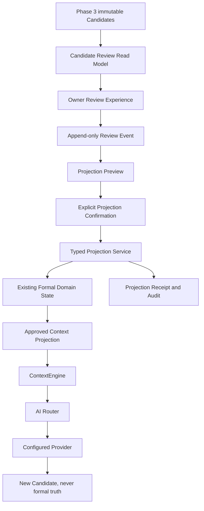
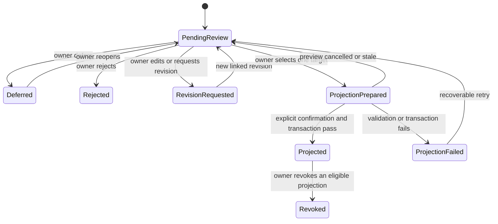
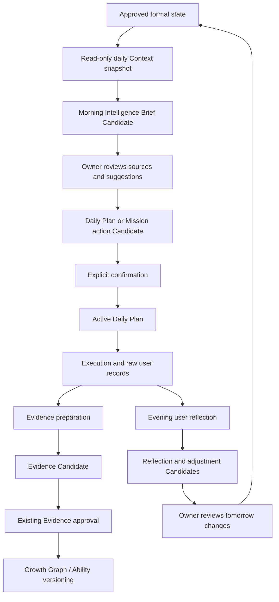

# Genesis OS Phase 4 Architecture Plan

Status: **architecture proposal only; no implementation authorization**

Proposed phase name: **Phase 4 Personal Operating Layer (POL)**

Planning baseline: Phase 3 Steps 1-10 at `8cb6b441a84513caccb615e2852a8a5c5d7d19c5`, plus the uncommitted Phase 3 Final Consolidation Review documents.

This document does not add a capability to the registry, create a migration, expose an API/UI, or change runtime behavior. The owner must approve a later implementation checkpoint explicitly.

## 1. Objective

Phase 4 should turn the internal, candidate-only intelligence foundations into understandable, reversible, user-controlled operating experiences.

The Personal Operating Layer must let the owner:

1. see why a Candidate exists and which sources support it;
2. accept, reject, defer, edit as a new user-authored revision, or approve a specific projection;
3. understand exactly which formal state would change before confirmation;
4. receive an auditable projection receipt after a successful change;
5. revoke or supersede eligible projections without rewriting history;
6. use approved intelligence in bounded Mentor and Daily Loop contexts;
7. move from daily guidance to action, Evidence, reflection, and Growth without automatic truth mutation.

## 2. Non-goals

Phase 4 must not:

- replace or weaken any Phase 0-3 Truth Contract;
- make one universal approval action promote every Candidate type;
- mutate a Phase 3 Candidate row from `pending/untrusted` into formal truth;
- infer final personality, identity, life mission, Ability, Growth, or Mastery;
- treat Research, summaries, AI scores, or reflections as demonstrated capability;
- bypass existing Memory, Evidence, Profile, Strategy, Mission, or Mastery approval services;
- inject pending, rejected, deferred, expired, revoked, or unvalidated data into ContextEngine;
- let a Provider or AI output approve its own result;
- create a parallel Context system, AI Router, Knowledge store, Memory store, or Daily Loop;
- claim real-user or production validation from fixtures or local automated tests.

## 3. Preserved architecture

Phase 4 is an orchestration and experience layer over existing foundations:

The direction is one-way and explicit. A Candidate may produce a review event. A review event may authorize one typed projection. Only the resulting formal record may become Context-eligible. A later AI call always creates advice or another Candidate, never a formal mutation.

## 4. Architectural layers

| Layer | Responsibility | Write authority |
| --- | --- | --- |
| Candidate sources | Preserve Phase 3 payload, provenance, trust, limitations, and source IDs. | Existing Phase 3 services only; still `pending/untrusted`. |
| Candidate catalog/read adapters | Present a normalized review envelope without copying truth claims. | Read-only adapters; a future source catalog may register identity/provenance only. |
| Review ledger | Append owner decisions such as defer, reject, request revision, or approve a named projection. | Explicit user action only. |
| Projection preview | Explain target, field-level effects, dependencies, conflicts, and reversibility. | No formal state write. |
| Typed projection services | Call the existing domain service inside one transaction. | Only after explicit confirmation for one target truth class. |
| Projection receipts | Record source Candidate, decision, target record/version, actor, time, and result. | Transactional audit write; never source content fabrication. |
| Context projection | Build typed, versioned read models from active formal records. | Read-only; eligibility is derived, not AI-selected. |
| Personal Operating UI | Review, daily workflow, and domain-specific explanations. | Uses guarded APIs; no direct database or Provider access. |

## 5. Truth projection rules

### 5.1 Core rules

1. Candidate acceptance is not formal projection.
2. Formal projection is not automatic Context eligibility.
3. Context eligibility is not permanent; revocation, supersession, expiry, deletion, or invalid provenance removes the record from future packets.
4. The Phase 3 Candidate remains immutable. Review and projection state is append-only and computed from later events.
5. Every projection names exactly one target truth class and one existing domain service.
6. A projection cannot raise its source trust. The formal target applies its own evidence and approval requirements.
7. User edits create a new user-authored revision linked to the original Candidate; they never overwrite AI history.
8. Rejection is terminal for that Candidate revision but does not delete it or its provenance.
9. Defer changes queue state only and creates no formal record.
10. Batch approval is prohibited for Profile, Memory, Ability, Growth, Mastery, Strategy, Mission, identity, value, and life-direction projections.

### 5.2 Domain projection matrix

| Candidate domain | Allowed future projection | Required boundary | Context result |
| --- | --- | --- | --- |
| AI Knowledge object | Approved Knowledge object only | Existing Knowledge decision order and source dependency validation | Task-relevant `knowledgeContext`; never Memory or Ability by implication |
| Knowledge analysis | No direct personal truth projection | May create reviewed learning/reference Candidates only | Not directly eligible |
| Learning Goal Candidate | User-confirmed formal Learning Goal | New typed adapter into existing Learning service; measurable outcome required | Current `learningContext` only |
| Learning time/path Candidate | Versioned study-plan proposal | Workload remains a range; cannot claim mastery time or waive a Gate | Approved current plan only |
| Learning progress preparation | Evidence Candidate handoff | Existing Evidence Candidate creation and later Evidence approval | Not eligible until formal Evidence exists |
| Ability/Growth Candidate | No direct Ability/Growth write | Must pass Evidence Engine and existing Growth approval/versioning | Approved Ability snapshot/Growth record only |
| Digital Twin signal | Profile Update Proposal, never final personality | Existing Profile proposal and explicit Profile fact approval | Active approved Profile fact only |
| Preference/value observation | Optional user-confirmed Profile or Memory Candidate | Separate target selection and existing approval; no stable identity inference | Only resulting active formal record |
| Decision analysis | Saved decision review or user-authored note | No judgment, ranking, or automatic recommendation | Recent operational context only when explicitly retained |
| Reflection/Mentor Candidate | User-owned reflection, Knowledge note, or Evidence Candidate | Separate opt-in per target; low-trust reflection cannot independently raise Ability | Existing daily/recent context rules; no identity promotion |
| Strategic Goal Direction | Strategy Candidate | Existing Strategy Candidate approval remains mandatory | Active formal Strategy only |
| Mission hypothesis | Mission Candidate | Must reference an approved Goal/Strategy and pass existing Mission approval | Active formal Mission only |
| Life mission/value/direction | No final identity truth | May remain a reflection or create a separately reviewed Profile/Memory Candidate | No direct Context eligibility |
| Goal alignment analysis | Decision aid only | User decides; analysis cannot accept/reject an opportunity | No direct formal or Context projection |

### 5.3 Truth transition record

Every future projection receipt must contain:

- immutable Candidate ID and Candidate type;
- source IDs and source trust classes;
- owner decision event ID;
- exact target truth class and target service;
- preview hash and confirmed effect hash;
- resulting target record ID and version;
- actor, timestamp, idempotency key, and request hash;
- success/failure without sensitive payload duplication;
- revocation/supersession link when applicable.

## 6. Candidate approval flow

These are computed review states, not updates to Phase 3 Candidate rows. `Projected` means a receipt points to a formal target; it does not mean the original Candidate became trusted.

### Review interaction requirements

The owner must see, before deciding:

- Candidate type and proposed target;
- exact source IDs, source kinds, timestamps, and confidence;
- observations separated from inferences;
- contradictions, missing evidence, and limitations;
- what will change and what explicitly will not change;
- whether the projection can be revoked and what revocation means;
- stale-preview warning when the target changed after preview generation.

## 7. ContextEngine integration boundary

### 7.1 Eligible inputs

Only active, approved, non-revoked formal records may enter a normal context packet:

- approved Knowledge with valid provenance and task relevance;
- confirmed active Memory;
- active Profile facts with approval/evidence history;
- formal Learning Goals and approved current paths;
- verified Evidence and approved Ability/Growth snapshots;
- active Strategy and Mission records;
- confirmed Daily Plans and bounded recent user reflections;
- typed Context projections carrying source IDs, truth class, confidence, timestamp, version, and eligibility reason.

### 7.2 Ineligible inputs

- every raw Phase 3 Candidate table;
- review queue position, defer/reject events, and projection previews;
- failed or rolled-back projections;
- revoked, superseded, archived, deleted, stale-invalid, or provenance-invalid records;
- unvalidated Research results as personal truth;
- Provider fallback text represented as verified fact;
- inferred personality, mission, value, or Ability without its formal domain contract.

### 7.3 Context assembly rules

- Extend the existing ContextEngine packet; never create a parallel context engine.
- Query typed read models, not arbitrary Candidate JSON.
- ContextEngine remains read-only. It may not approve, project, repair, or refresh formal state while building a packet.
- Apply task-purpose filtering, least-data disclosure, deterministic ranking, character/token budgets, and source whitelists.
- Preserve truth class and distinguish user report, approved fact, verified Evidence, external reference, and AI inference.
- Expose truncation, contradiction, staleness, and missing-source metadata to downstream prompt builders.
- Cache keys must include formal record versions and revocation state so stale Context cannot survive a truth change.

## 8. AI Router usage boundary

1. Every generative Personal Operating task must call `ContextEngine.complete` or `ContextEngine.stream`, which delegates to AI Router.
2. UI, API routes, domain projection services, and repositories may not instantiate Provider adapters.
3. Deterministic review, eligibility, projection validation, and audit logic must not call AI.
4. Provider output must pass a task-specific Zod schema and source-ID whitelist before persistence as a Candidate.
5. Provider, model, task type, tokens, latency, cost, prompt version, success, and redacted error state remain logged server-side.
6. Timeout, retry, or fallback may create an explicitly labelled low-confidence Candidate or recoverable error, but never a formal projection.
7. Tavily Research remains behind Research Engine as an external reference provider; Research results do not become personal truth or bypass Knowledge approval.
8. No prompt, raw private source, API key, or unrelated Context may enter usage analytics.

## 9. User interaction model

### 9.1 Review Center

A future `/intelligence` Review Center should provide one dense, work-focused queue rather than separate disconnected candidate pages. It should support:

- filters by domain, age, source, and review state;
- one Candidate detail view with provenance and impact preview;
- reject, defer, request revision, and typed projection actions;
- no sensitive batch approval;
- audit receipt and revocation history;
- honest empty, loading, stale, conflict, Provider-failed, and transaction-failed states.

The planning route is not implemented by this document.

### 9.2 Embedded domain review

Existing Knowledge, Learning, Growth Graph, Memory, Mentor, Strategy, Mission, and Today surfaces may later show filtered review panels. They must use the same review service and ledger as the Review Center, not duplicate approval logic.

### 9.3 Interaction principles

- Show the next decision, not an opaque AI score.
- Keep source evidence visible beside the claim.
- Separate "save for later", "accept as useful", and "change formal state".
- Require a second confirmation for consequential projections.
- Explain why an action is unavailable and how to recover.
- Preserve keyboard, 390px, and 430px usability without hiding provenance or confirmation controls.
- Avoid dependency-forming, diagnostic, manipulative, or shame-based language.

## 10. Daily intelligence workflow

### Morning

1. Build a read-only snapshot from approved Goal, Strategy, Mission, Memory, Knowledge, Evidence, Learning, and Daily state.
2. Generate a Morning Intelligence Brief Candidate through ContextEngine and AI Router.
3. Cite the formal source IDs and clearly label inference.
4. Let the owner select actions; selection creates or updates only the existing Candidate/plan workflow.
5. Require explicit confirmation before a Daily Plan becomes active.

### During the day

1. Record execution as user-owned operational data.
2. Keep Mission status, task completion, blockers, assistance, and source links factual.
3. Prepare Evidence Candidates without changing Ability, Growth, or Mastery.
4. A Provider failure must not mark work complete or fabricate Evidence.

### Evening

1. Preserve the owner's raw reflection before derived analysis.
2. Generate Reflection, Knowledge, Memory, Evidence, or tomorrow-adjustment Candidates separately.
3. Require separate decisions for each target truth class.
4. Never rewrite Goal, Strategy, Mission, identity, or Memory from the reflection.
5. Carry only confirmed operational changes into the next morning snapshot.

## 11. Proposed implementation order

Each step is a separate future checkpoint with owner review. This document implements none of them.

1. **P4 Step 0 - Operating Truth Contract:** approve terminology, review event model, projection matrix, revocation semantics, and Context eligibility rules.
2. **P4 Step 1 - Candidate Review Read Models:** read-only adapters and deterministic queue aggregation; no decision writes or formal projection.
3. **P4 Step 2 - Review Ledger and Projection Receipts:** append-only owner events, idempotency, stale-preview protection, audit, and restore compatibility; still no domain projection.
4. **P4 Step 3 - Knowledge and Learning Activation:** typed Knowledge and Learning Goal/path projections using existing services and explicit confirmation.
5. **P4 Step 4 - Evidence and Growth Handoff:** route preparation records into existing Evidence Candidate and Growth approval loops; never direct Ability/Growth mutation.
6. **P4 Step 5 - Personal Model Review:** Profile/Memory projection proposals, contradiction handling, revocation, sensitive-data controls, and no final personality truth.
7. **P4 Step 6 - Decision and Reflection Experience:** save reviews and reflections without judgment; separate optional Knowledge/Memory/Evidence projections.
8. **P4 Step 7 - Strategy and Mission Alignment:** typed handoff to existing Strategy and Mission Candidate approval loops; no automatic prioritization.
9. **P4 Step 8 - Approved Context Projections:** add typed, versioned, revocation-aware Context read models and negative isolation tests.
10. **P4 Step 9 - Daily Personal Operating Workflow:** connect Morning Brief, confirmed Daily Plan, execution, Evidence, reflection, and next-day adjustment on Today.
11. **P4 Step 10 - Real-use validation:** 30-day owner validation, accessibility/mobile review, failure recovery, privacy, performance, and capability status review.

Lower-risk Knowledge/Learning projections precede sensitive Profile/Memory and Strategy/Mission projections. Context integration occurs only after projection and revocation contracts are proven.

## 12. Future migration strategy

No migration is created during planning. If implementation is approved:

- continue additively from `0045`; one reviewed migration per implementation checkpoint;
- never drop, rename, repurpose, or bulk-rewrite an existing core or Phase 3 table;
- keep Phase 3 Candidate payloads immutable;
- introduce a source-validated Candidate catalog only if every catalog entry is tied to a real typed source row;
- store review decisions as append-only events, not a mutable generic status column;
- store projection receipts separately from source Candidates and formal targets;
- prefer domain-specific foreign keys or database-validated source registration; never accept an unchecked polymorphic ID;
- make backfills idempotent and metadata-only; no historical Candidate becomes approved or projected during migration;
- add immutable/audit guards before enabling any projection service;
- extend export/import in dependency order and verify restore never promotes Candidates;
- rehearse forward migration, repeated migration, backup restore, rollback-by-new-migration, foreign-key checks, and database integrity checks.

## 13. Future API strategy

Proposed routes are design placeholders and are not implemented:

| Method and route | Purpose | Boundary |
| --- | --- | --- |
| `GET /api/intelligence/review` | Read a filtered Candidate review queue. | Side-effect free; bounded pagination. |
| `GET /api/intelligence/review/[id]` | Read Candidate provenance, conflicts, limitations, and computed review state. | No Context or formal mutation. |
| `POST /api/intelligence/review/[id]/preview` | Produce a deterministic field-level projection preview. | No formal write; target version included. |
| `POST /api/intelligence/review/[id]/decisions` | Append reject, defer, reopen, revision request, or projection authorization. | Origin guard, Zod, idempotency, explicit actor. |
| `POST /api/intelligence/review/[id]/project` | Confirm one typed projection using an existing domain service. | Transactional receipt; stale preview rejected. |
| `POST /api/intelligence/projections/[id]/revoke` | Append revocation and invoke domain-specific reversal/supersession rules. | Never delete history; only eligible targets. |

API requirements:

- no command disguised as GET;
- server-only database and Provider access;
- current origin guard, authentication/deployment boundary, Zod parsing, request limits, and redacted logging;
- idempotency and optimistic target-version checks on every consequential POST;
- domain services are called directly in-process, never through internal HTTP;
- transaction failure rolls back formal target and receipt together;
- error responses distinguish validation, stale preview, conflict, forbidden projection, Provider failure, and persistence failure.

## 14. Future UI strategy

1. Add at most one primary Review Center and reuse it through filtered embedded panels.
2. Keep Today as the daily operating surface rather than creating a competing dashboard.
3. Use existing Knowledge, Learning, Growth, Memory, Mentor, Strategy, and Mission pages for domain detail.
4. Present provenance, confidence, limitations, target impact, and approval controls in one visible hierarchy.
5. Use explicit confirmation dialogs only for consequential projections; routine defer/reject remains efficient.
6. Show receipt, resulting formal record, and undo/revocation eligibility after projection.
7. Provide real empty/loading/error/conflict/stale/offline states.
8. Preserve 390px/430px no-overflow, keyboard access, focus restoration, and readable source IDs.
9. Do not expose a control until its service, persistence, failure recovery, tests, and audit path are complete.

## 15. Safety boundaries

- **Truth:** AI produces Candidates; only the owner authorizes a typed projection.
- **Mastery:** all eight Gates remain mandatory; plans, completion, time, and AI scores cannot certify Mastery.
- **Evidence:** preparation is not Evidence; Evidence approval remains separate from Ability/Growth approval.
- **Memory/Profile:** no automatic durable identity write; contradiction, revocation, and source history remain visible.
- **Decision/Mission:** no automatic judgment, prioritization, opportunity acceptance, identity conclusion, or life mission.
- **Context:** only active formal projections enter; Candidates and review metadata remain excluded.
- **AI:** all business AI uses ContextEngine and AI Router; outputs are schema/source validated.
- **Security:** secrets remain server-only; no raw private content in analytics or audit duplication.
- **Reliability:** provider, database, restore, and projection failures leave formal state unchanged.
- **No regression:** Capability Constitution remains the floor; compatibility and rollback precede any deprecation.

## 16. Required verification for every future step

- pre/post Capability Registry 40/40 or higher with 0 violations and no removal;
- ordered additive migration, repeat migration, SQLite integrity, and foreign-key checks;
- unit tests for allowed projection and every forbidden bypass;
- Context packet before/after tests for pending, rejected, revoked, and approved states;
- AI Router boundary tests and Provider failure isolation;
- backup/export/restore tests without implicit promotion;
- API origin, schema, idempotency, stale-version, and transaction rollback tests;
- UI happy, empty, loading, error, conflict, and revocation states;
- complete E2E and 390px/430px no-overflow checks;
- typecheck, lint, unit/integration, build, E2E, dependency audit, production readiness, secret scan, and diff check.

## 17. Owner decisions required

Before any Phase 4 code, the owner must approve:

1. the unique name **Phase 4 Personal Operating Layer** and its separation from the historical Cognition Growth phase label;
2. the immutable Candidate plus append-only Review Event model;
3. the domain projection matrix and domains that intentionally have no direct projection;
4. two-step confirmation and no-sensitive-batch-approval rules;
5. revocation, supersession, and stale-preview behavior;
6. approved Context projection types and retention limits;
7. the proposed implementation order and first smallest vertical loop;
8. real-user validation criteria before any capability status upgrade.

## 18. Stop gate

Stop after architecture planning. Do not create migration `0045`, runtime services, routes, pages, registry entries, or Phase 4 tests until the owner approves a specific implementation step.
