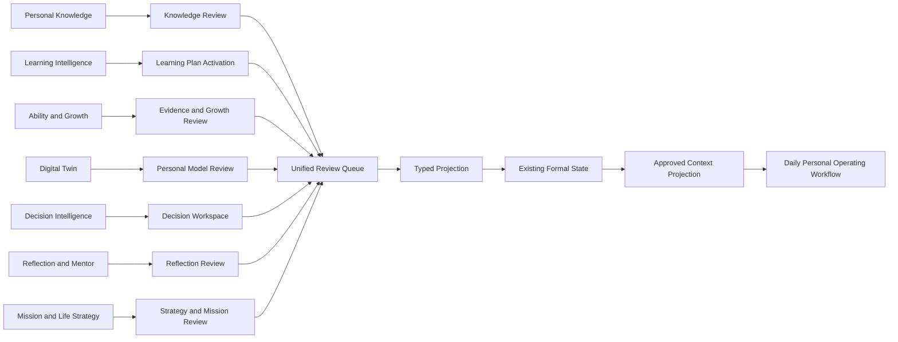

# Genesis OS Phase 4 Capability Map

Status: **architecture map with implementation progress recorded through Step 8; this document does not authorize Step 9**

Phase name: **Phase 4 Personal Operating Layer (POL)**

The IDs below are planning identifiers, not additions to `genesisCapabilityRegistry`. Existing registry IDs remain the constitutional baseline.

Implementation checkpoint: `P4-POL-01` through the currently scoped portions of `P4-POL-11` and `P4-POL-14` are implemented through additive migrations `0045`-`0051` and remain subject to their individual Owner Review reports. Step 8 adds the Receipt-governed, purpose-scoped Approved Context Projection read path inside the existing ContextEngine. `P4-POL-12`, `P4-POL-13`, Step 9 workflow work, and real-use validation have not started.

## 1. Capability map

| Planning ID | Proposed capability | Existing foundation / registry contract | User experience | Allowed formal effect | Context rule | Proposed step |
| --- | --- | --- | --- | --- | --- | --- |
| `P4-POL-01` | Candidate Review Read Model | Phase 3 Candidate tables; `governance.no_regression` | One explainable queue with provenance, trust, limits, conflicts, and computed review state | None | Never Context-eligible | Step 1 |
| `P4-POL-02` | Owner Review Ledger | Existing approval/audit patterns; `evidence.approval_audit` | Reject, defer, reopen, request revision, or authorize one projection | Append review event only | Review events excluded | Step 2 |
| `P4-POL-03` | Typed Projection Preview and Receipt | Existing domain services and audit logs | Field-level effect preview, confirmation, receipt, and conflict recovery | One typed target per explicit confirmation | Receipt excluded; target evaluated separately | Step 2 |
| `P4-POL-04` | Knowledge Activation | `knowledge.memory_intelligence`, Knowledge Truth Contract | Review AI Knowledge with sources and dependency order | Approved Knowledge object through existing decision semantics | Approved task-relevant Knowledge only | Step 3 |
| `P4-POL-05` | Learning Goal and Path Activation | `learning.goal_resource_management`, `learning.time_estimator`, `learning.dynamic_curriculum` | Turn reviewed material intelligence into a measurable Goal and versioned study plan | User-confirmed Learning Goal/path; no Mission or Mastery | Current approved learning state only | Step 3 |
| `P4-POL-06` | Learning Evidence Handoff | `evidence.approval_audit`, `learning.deep_assessment` | Review progress preparation and submit a traceable Evidence Candidate | Evidence Candidate only; existing Evidence approval still required | Not eligible before formal Evidence | Step 4 |
| `P4-POL-07` | Ability and Growth Review | `growth.graph_ability_change`, Mastery Truth Contract | Compare Candidate signals with verified Evidence and explain missing proof | Existing Growth/Ability candidate and approval/versioning flow only | Approved snapshots only | Step 4 |
| `P4-POL-08` | Personal Model Review | `identity.profile_fact_governance`, `knowledge.memory_intelligence` | Review observations, preferences, contradictions, sensitivity, and retention | Profile Proposal or Memory Candidate, each separately approved | Active approved fact/Memory only | Step 5 |
| `P4-POL-09` | Decision and Reflection Workspace | Phase 3 Decision and Reflection/Mentor foundations; `mentor.genesis_ai_mentor` | Inspect factors, alternatives, reflection, and thinking prompts without judgment | User-owned decision review, note, or separately selected Candidate target | Bounded recent state only after explicit retention | Step 6 |
| `P4-POL-10` | Strategy and Mission Alignment Review | `strategy.mission_ceo` | Compare direction hypotheses with active Goal/Strategy/Mission and source conflicts | Existing Strategy Candidate or Mission Candidate flow only | Active formal Strategy/Mission only | Step 7 |
| `P4-POL-11` | Approved Context Projection | `context.personal_context_engine` | Show which approved facts will be used and why | Read-only typed projection; no truth write | Only active formal versions with eligibility reason | Step 8 |
| `P4-POL-12` | Personal Operating AI Orchestration | `ai.multi_provider_router`, `mentor.genesis_ai_mentor` | Source-grounded Brief, review, and adjustment Candidates | Candidate only | ContextEngine -> AI Router -> Provider required | Steps 8-9 |
| `P4-POL-13` | Daily Intelligence Workflow | `daily.learning_loop`, existing Daily Life and Personal Operating loops | Morning Brief -> confirmed plan -> execution -> Evidence -> reflection -> next-day review | Existing confirmation and Evidence flows only | Confirmed operational state only | Step 9 |
| `P4-POL-14` | Projection Revocation and Supersession | Existing versioning, archive, and audit patterns | Revoke eligible projections and see downstream Context effect | Domain-specific append-only reversal or supersession | Revoked versions excluded immediately | Steps 2-9 |
| `P4-POL-15` | Real-use Validation | `intelligence.weekly_monthly_proactive`, Usage/Beta validation capabilities | 30-day local owner validation with factual metrics | Capability status evidence only after owner review | No private analytics content | Step 10 |

## 2. Foundation-to-experience mapping



## 3. Existing capability preservation map

| Existing contract | Phase 4 preservation rule | Forbidden shortcut |
| --- | --- | --- |
| `governance.no_regression` | Keep every registered path, route, table, guard, test, and product region unless a compatible replacement is fully proven. | Removing a capability to simplify the Review Center |
| Knowledge Truth Contract | Preserve reference, raw Knowledge, Candidate, approved Knowledge, Memory, Evidence, Ability, and Mastery distinctions. | Treating saved/liked content as confirmed Memory or learned capability |
| `learning.mastery_graduation_gate` | Keep all eight hard Gates, aggregate threshold, remediation, retake, assistance, and delayed recall. | Projecting plan completion or AI score into Mastery |
| `knowledge.memory_intelligence` | Continue explicit Memory Candidate confirmation and active-version rules. | Digital Twin or reflection directly writing Memory |
| `evidence.approval_audit` | Preparation -> Evidence Candidate -> explicit Evidence approval remains intact. | Ability layer creating verified Evidence directly |
| `growth.graph_ability_change` | Ability/Growth changes remain evidence-linked and versioned. | Approving an Ability hypothesis as a formal level |
| `identity.profile_fact_governance` | Digital Twin outputs may create Profile Proposals only; existing approval and evidence remain mandatory. | Defining final personality or identity from aggregation |
| `context.personal_context_engine` | Extend typed read models inside the existing packet and budget. | Querying Candidate JSON or creating a second Context path |
| `ai.multi_provider_router` | All business AI stays behind ContextEngine and Router with schemas and usage logs. | UI/API/service instantiating Provider adapters directly |
| `mentor.genesis_ai_mentor` | Advice remains sourced and separated from formal truth. | Mentor approving its own recommendation |
| `strategy.mission_ceo` | Use existing Strategy and Mission Candidate approval loops. | Life Strategy output creating active Strategy/Mission directly |
| `daily.learning_loop` | Preserve raw reflection, confirmed plan, Evidence handoff, and idempotency. | Morning/Evening AI silently changing tomorrow's formal plan |
| `data.backup_restore_export` | Export review events, receipts, revocations, and dependencies in order. | Restore promoting pending Candidates or overwriting newer truth |
| `security.public_production_hardening` | Keep secrets server-only and local/public deployment claims explicit. | Exposing sensitive Candidate payloads or keys client-side |

## 4. Truth-transition ownership

| Transition | Who may initiate | Deterministic authority | AI role |
| --- | --- | --- | --- |
| Candidate -> review event | Owner | Review service validates Candidate/source/version | Explain only |
| review event -> projection preview | Owner | Typed projection adapter computes effects | Optional explanation; cannot choose target |
| preview -> formal projection | Owner confirmation | Existing formal domain service and transaction | None |
| formal record -> Context read model | System read path | Static eligibility rules over formal state | None |
| Context -> new analysis | Owner/system-triggered allowed workflow | ContextEngine and AI Router | Generate Candidate only |
| projection -> revocation/supersession | Owner | Domain-specific version/audit service | Explain consequences only |

No transition grants AI write authority over formal truth.

## 5. Context eligibility by capability

| Capability area | Pending/rejected/deferred | Accepted as useful | Formally projected and active | Revoked/superseded |
| --- | --- | --- | --- | --- |
| Knowledge | Excluded | Excluded unless separately approved as Knowledge | Task-relevant `knowledgeContext` | Excluded |
| Learning | Excluded | Excluded | Current `learningContext` | Excluded |
| Evidence | Excluded | Excluded | Verified Evidence partitions | Excluded or historical-only, never current truth |
| Ability/Growth | Excluded | Excluded | Approved versioned snapshot | Prior version retained for history, excluded as current |
| Profile/Memory | Excluded | Excluded | Active approved fact/Memory | Excluded |
| Decision/Reflection | Excluded | Review UI only | Bounded recent context only when explicitly retained | Excluded |
| Strategy/Mission | Excluded | Review UI only | Active formal Strategy/Mission | Excluded |
| Life mission/value/alignment | Excluded | Reflection UI only | No direct projection class | Excluded |

## 6. Proposed dependency order

```text
P4-POL-01 Candidate Review Read Model
  -> P4-POL-02 Owner Review Ledger
  -> P4-POL-03 Preview and Receipt
      -> P4-POL-04 Knowledge Activation
      -> P4-POL-05 Learning Activation
          -> P4-POL-06 Evidence Handoff
          -> P4-POL-07 Ability/Growth Review
      -> P4-POL-08 Personal Model Review
      -> P4-POL-09 Decision/Reflection Workspace
      -> P4-POL-10 Strategy/Mission Review
  -> P4-POL-14 Revocation/Supersession per domain
  -> P4-POL-11 Approved Context Projection
  -> P4-POL-12 AI Orchestration
  -> P4-POL-13 Daily Intelligence Workflow
  -> P4-POL-15 Real-use Validation
```

Context projection cannot precede domain projection and revocation semantics. Daily orchestration cannot precede Context projection. Real-use validation cannot precede a complete daily vertical loop.

## 7. Capability acceptance gates

Every future capability slice must prove:

1. its source Candidate and provenance are real and immutable;
2. pending, rejected, deferred, stale, and revoked states remain outside formal Context;
3. owner intent names exactly one target truth class;
4. preview and target version match at confirmation time;
5. formal target and projection receipt commit or roll back together;
6. no direct mutation exists for Memory, Evidence, Ability, Growth, Mastery, Profile, Goal, Strategy, or Mission outside its existing service;
7. AI and Provider failures cannot create a receipt or formal state;
8. export/restore preserves review and projection history without promotion;
9. existing Capability Registry checks and full regression suite remain green;
10. user-facing controls include real success, empty, loading, conflict, error, and recovery behavior.

## 8. Capability status policy

- Planning IDs remain documentation-only until a separately approved implementation step.
- A future implementation must map each shipped surface into `genesisCapabilityRegistry` without deleting or downgrading existing IDs.
- `implemented` requires a real persisted service boundary, not schema or UI alone.
- `local_loop_verified` requires a complete local vertical loop and E2E coverage.
- `real_user_verified` requires owner-reviewed use with real data and outcomes; fixtures do not qualify.
- `production_verified` requires the separately approved deployment, security, persistence, recovery, and operations standard.

## 9. Owner review checklist

- [ ] Approve the proposed Phase 4 name and historical naming separation.
- [ ] Approve planning capabilities `P4-POL-01` through `P4-POL-15` as a map, not implementation authorization.
- [ ] Approve domain-specific truth projections and intentional no-projection domains.
- [ ] Approve immutable Candidate and append-only Review Event semantics.
- [ ] Approve approved-only Context projection and revocation behavior.
- [ ] Approve implementation dependency order.
- [ ] Select the first smallest complete vertical loop for a later coding request.

## 10. Historical planning stop gate

This was the planning-time stop gate before implementation authorization. It was satisfied before Phase 4 coding began. Subsequent owner-approved implementation steps are mapped below and in their step reports; the original planning IDs remain an architectural map rather than independently claimed runtime capabilities.

## 11. Implemented Step 9 mapping: Daily Personal Operating Workflow

Phase 4 Step 9 implements the daily vertical loop by extending the existing Personal Operating capability; it does not create an unrelated second loop.

| Daily capability | Runtime owner | Persistence / source | Boundary |
| --- | --- | --- | --- |
| Daily Operating State | `lib/services/daily-operating-state-service.ts` | formal Mission/Learning/Project state, current approved plan, append-only execution events, eligible Approved Context | Deterministic owner-scoped read only; missing inputs remain explicit |
| Morning Brief vNext | `lib/services/personal-operating-service.ts` | existing `morning_briefs` | `daily_operation` plus `approvedOnly`; deterministic fallback does not fabricate intelligence |
| Daily Plan Candidate | `lib/services/personal-operating-service.ts` | existing `daily_plan_candidates` | AI output stays pending until explicit owner confirmation |
| Formal Daily Plan | existing Personal Operating approval path | existing `daily_plans` plus migration `0053` guard | Historical source and plan payload are protected from mutation |
| Owner defer/revision | existing Personal Operating command path | `daily_plan_owner_review_events` from migration `0054` | Append-only events; no activation or truth projection |
| Plan execution facts | existing Personal Operating command path | `daily_plan_block_events` from migration `0052` | Completion does not create verified Evidence, Ability, Growth, or Mastery |
| Evening Reflection vNext | existing Personal Operating reflection path | existing `operating_reflections` with additive raw fields | Raw owner text is persisted before AI analysis |
| Follow-up intelligence | existing Personal Operating reflection path | isolated Candidate sets/rows from migration `0052` | `pending/untrusted`, Context-ineligible, formal mutation forbidden |
| Daily Close | `lib/services/daily-operating-state-service.ts` | daily facts, owner self-report, isolated AI Candidates | Facts, self-report, and inference remain separate |
| Today command center | `components/personal-operating-loop.tsx` | existing `/api/personal-operating` surface | Incremental UI; owner controls remain authoritative; 390/430 responsive |

Implemented Step 9 data flow:

```text
Approved Context Projection (daily_operation)
  -> deterministic Daily Operating State
  -> Morning Brief vNext
  -> Daily Plan Candidate
  -> Owner confirmation
  -> formal Daily Plan
  -> append-only execution facts
  -> raw Evening Reflection
  -> pending follow-up Candidates
  -> Daily Close
```

Step 9 does not change the Knowledge, Mastery, Memory, Evidence, Ability/Growth, Profile/Digital Twin, Strategy, Mission, ContextEngine, AI Router, or Provider ownership rules. It does not implement scheduler, notifications, cloud synchronization, authentication migration, public deployment, or multi-Agent runtime. Automated tests do not make this capability `real_user_verified`.
