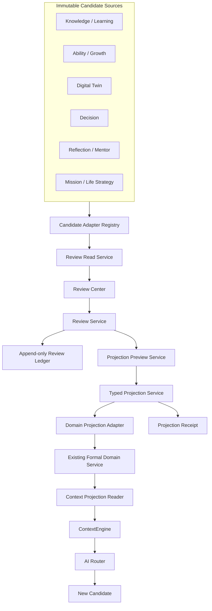

# Genesis OS Phase 4 Implementation Specification

Status: **implementation preparation only; architecture approved, coding not authorized**

Phase: **Phase 4 Personal Operating Layer (POL)**

Baseline: Phase 3 Steps 1-10 at `8cb6b441a84513caccb615e2852a8a5c5d7d19c5`.

Source plans:

- `docs/GENESIS_PHASE_4_ARCHITECTURE_PLAN.md`
- `docs/GENESIS_PHASE_4_CAPABILITY_MAP.md`
- `docs/GENESIS_PHASE_3_FINAL_AUDIT.md`

This specification defines future contracts. It does not create files outside `docs/`, migration `0045`, runtime behavior, routes, pages, registry entries, or tests.

## 1. Implementation objective

The Personal Operating Layer will make Phase 3 intelligence reviewable and actionable without turning AI output into user truth. It will provide one consistent owner-controlled path from an immutable Candidate to an optional, typed, auditable formal projection and then to an approved Context read model.

The implementation must preserve existing vertical loops. It coordinates them; it does not replace them.

## 2. Preserved contracts

| Contract or foundation | Mandatory preservation |
| --- | --- |
| Knowledge Truth Contract | External references, raw Knowledge, AI Knowledge Candidates, approved Knowledge, Memory, Evidence, Ability, and Mastery remain separate truth classes. |
| Mastery Truth Contract | All eight hard Gates, aggregate threshold, delayed recall, assistance/independence ledger, remediation, retake history, and Evidence handoff remain mandatory. |
| Memory approval boundary | Only explicit user confirmation through the existing Memory contract creates active long-term Memory. |
| Evidence approval boundary | Preparation and analysis create Evidence Candidates only; verified Evidence requires the existing approval path. |
| ContextEngine | Remains the only bounded personal context assembler and remains read-only. |
| AI Router | Remains the provider-neutral path for every generative business AI task. |
| Personal Knowledge Layer | Ownership, provenance, source relationships, validation, extraction, decisions, and legacy `knowledge_items` meaning remain intact. |
| Learning Intelligence Core | Goal, workload, path, recommendation, state, and progress preparations remain Candidates until a typed user projection. |
| Ability and Growth Intelligence | Hypotheses and trends cannot directly set Ability/Growth; approved Evidence and existing versioning remain mandatory. |
| Digital Twin Foundation | Signals remain observations, not final personality or profile truth. |
| Decision Intelligence Foundation | Factors and trade-offs remain unweighted decision aids, not judgments. |
| Reflection and Mentor Intelligence | Reflections and perspectives remain sourced Candidates without invented expert decisions. |
| Mission and Life Strategy Foundation | Mission, values, direction, strategic goals, and alignment remain hypotheses/questions until existing formal domain approval. |

No implementation choice may collapse these contracts into a generic `approved=true` truth model.

## 3. Target component architecture



## 4. Future module boundaries

The paths below are proposed targets, not files created by this specification.

| Proposed module | Responsibility | Allowed dependencies | Forbidden responsibility |
| --- | --- | --- | --- |
| `lib/domain/personal-operating-layer.ts` | Review actions, computed lifecycle, review envelope, preview and receipt schemas | Zod and pure domain helpers | Database, ContextEngine, Router, Provider, formal writes |
| `lib/domain/truth-projection.ts` | Typed target identifiers, effect model, reversibility rules, truth transition invariants | Pure domain types | Generic approval that bypasses domain rules |
| `lib/services/intelligence-review-read-service.ts` | Aggregate normalized Candidate envelopes through allowlisted adapters | Candidate adapters and repository reads | Candidate update, projection, Context write, Provider call |
| `lib/services/intelligence-review-service.ts` | Validate owner action, Candidate hash/version, lifecycle, idempotency, and append review events | Review repository and pure domain rules | Formal domain write or AI decision |
| `lib/services/projection-preview-service.ts` | Deterministically compute field-level effects, conflicts, target version, effect hash, and reversibility | Typed projection adapters in preview mode | Persist formal state or let AI select a target |
| `lib/services/truth-projection-service.ts` | Confirm a fresh preview, call exactly one typed adapter, and atomically record receipt | Review repository, typed adapter registry, existing domain services | Direct SQL into another domain's formal tables |
| `lib/services/context-projection-service.ts` | Build typed approved read projections and eligibility explanations | Formal repositories only | Candidate reads, approvals, repair, Provider calls |
| `lib/db/intelligence-review-repository.ts` | Candidate catalog metadata, append-only events, receipts, idempotency, read queries | SQLite only | Candidate payload ownership or domain projection logic |
| `lib/ai/personal-operating-analysis.ts` | Task-specific prompts and output schemas for Brief/adjustment Candidates | ContextEngine request contracts | Provider construction, formal state writes, approval logic |
| `app/api/intelligence/**` | Authenticate/guard, parse Zod input, call services, map domain errors | Server-only services | Database SQL, Provider access, hidden GET mutations |
| `components/intelligence-review-center.tsx` | Queue, detail, provenance, decisions, preview, confirmation, receipt states | API client and presentation helpers | Business rules, secrets, optimistic fake success |
| `components/daily-intelligence-workflow.tsx` | Compose existing Today sections with review and confirmed action state | Existing Today components and review API | Parallel Daily Loop or automatic plan activation |

### 4.1 Dependency direction

```text
UI -> API route -> application service -> domain rule / repository / typed adapter
typed adapter -> existing formal domain service
ContextEngine -> context projection reader -> formal repositories
ContextEngine -> AI Router -> Provider
```

Dependencies must not point backward. Repositories do not import services. Domain modules do not import database, UI, ContextEngine, Router, or Provider code. Typed projection adapters do not call internal HTTP routes.

## 5. Data ownership rules

| Data class | Owner | Authoritative writer | Mutability | Context eligibility |
| --- | --- | --- | --- | --- |
| Raw user input/content | User | Existing input/Knowledge/Daily services | Versioned or soft-deleted under existing rules | Only through existing bounded rules |
| External Research/reference | Source plus user collection ownership | Research/Knowledge services | Historical source record retained | Reference-only, task-scoped, never personal truth |
| Phase 3 Candidate payload | AI or deterministic Candidate service; user owns stored data | Existing Phase 3 Candidate service | Immutable | Never directly eligible |
| Candidate catalog metadata | System metadata for user-owned Candidate | Review repository after source validation | Append/register once; no payload copy | Never eligible |
| Review event | User decision | Review service | Append-only | Never eligible |
| Projection preview | Deterministic transient calculation | Preview service | Not authoritative; recomputed at confirmation | Never eligible |
| Formal domain record | User | Existing typed formal domain service | Existing version/approval rules | Eligible only under domain rule |
| Projection receipt | User-authorized system audit | Truth Projection service in target transaction | Append-only | Never eligible |
| Context projection | Derived read model | Context projection reader | Rebuilt from current formal versions | Eligible read output, not new truth |
| AI usage telemetry | System metadata | AI Router | Append-only/redacted | Never personal Context |

### 5.1 Ownership invariants

- Every record includes `user_id`, even in local single-user mode.
- The Candidate's user, review event user, target user, and receipt user must match.
- AI cannot be the actor for review, projection confirmation, revocation, or supersession.
- Audit and telemetry must store hashes/IDs and minimal metadata, not duplicate raw private payloads.
- Deletion, archive, revocation, and supersession follow the target domain's existing rules; the ledger preserves minimal non-content audit history.
- Export/restore preserves ownership and dependency order and cannot change a computed review state into a more trusted state.

## 6. Candidate adapter contract

The Review Read Service must not run arbitrary table names or deserialize unknown Candidate JSON. Each Candidate family requires an allowlisted adapter.

Every adapter returns a normalized Review Envelope:

| Field | Requirement |
| --- | --- |
| `catalogId` | Opaque review identifier; never exposes a writable table selector |
| `candidateType` | Closed enum tied to one adapter |
| `sourceCandidateId` | Immutable source row ID |
| `sourceCandidateHash` | Canonical hash of projection-relevant source fields |
| `userId` | Must equal the authenticated/current owner |
| `domain` | Knowledge, Learning, Evidence, Ability, Profile, Decision, Reflection, Strategy, Mission, or no-projection reflection |
| `createdAt` | Original Candidate timestamp |
| `trustClass` | Must preserve original trust, normally `untrusted` |
| `sourceIds` | Validated provenance references |
| `observations` | Source-backed observations only |
| `inferences` | Separately labelled model/deterministic inferences |
| `confidence` | Bounded and supported; no false precision |
| `limitations` | Missing evidence, contradictions, fallback, stale or parser limitations |
| `allowedTargets` | Static adapter-defined projection targets; empty for no-projection types |
| `computedReviewState` | Derived from immutable Candidate plus append-only events/receipts |
| `contextEligible` | Always `false` for the envelope |

### 6.1 Initial adapter families

- Personal Knowledge and Knowledge Analysis
- Learning Material and Personal Learning Intelligence
- Learning Progress Evidence Preparation
- Ability and Growth Intelligence
- Digital Twin signals and aggregation
- Decision Intelligence
- Reflection and Mentor Intelligence
- Mission and Life Strategy Intelligence

An adapter cannot be registered until its truth target, no-projection cases, source validation, redaction, tests, and owner-visible language are approved.

## 7. Review lifecycle and approval workflow

### 7.1 Review actions

| Action | Formal effect | May later reopen | Notes |
| --- | --- | --- | --- |
| `defer` | None | Yes | Requires optional revisit time; never Context-eligible |
| `reopen` | None | N/A | Returns a deferred recoverable item to review |
| `reject` | None | No for that revision | New evidence requires a new linked Candidate revision |
| `request_revision` | None | Via new revision | Original Candidate remains immutable |
| `acknowledge` | None | Yes | Marks useful/seen only; not approval or Context eligibility |
| `authorize_projection` | Authorization event only | Until projected/stale | Names exactly one target and one preview hash |
| `revoke_projection` | Domain-specific reversal/supersession | Domain-defined | AI cannot invoke it |

### 7.2 Computed review states

`pending_review`, `deferred`, `rejected`, `revision_requested`, `projection_prepared`, `projection_failed`, `projected`, `revoked`, and `superseded` are computed from events and receipts. They are not written into Phase 3 Candidate tables.

### 7.3 Approval sequence

1. Owner opens a Candidate envelope.
2. Server revalidates source existence, owner, trust, terminal state, and hash.
3. Owner selects one adapter-allowed target.
4. Preview service loads the current target and dependencies.
5. Preview returns exact effects, non-effects, conflicts, reversibility, target version, Candidate hash, and effect hash.
6. UI displays an explicit confirmation; sensitive domains prohibit batch confirmation.
7. Confirmation submits client request ID, Candidate hash, preview/effect hash, target version, and target type.
8. Server rejects stale Candidate, stale target, mismatched owner, invalid target, duplicate conflicting request, or missing dependency.
9. In one transaction, the typed adapter invokes the existing formal domain service and the Projection service writes the committed receipt.
10. UI reads the receipt and real target record before showing success.
11. Context cache/version is invalidated by formal version change, not by client optimism.

Accepting or acknowledging a Candidate stops at step 1/ledger and never reaches formal projection.

## 8. Projection pipeline details

### 8.1 Typed adapter interface

Every future projection adapter must specify:

- one source Candidate type;
- one target truth class;
- source and dependency validation;
- preview calculation;
- existing formal service method invoked;
- idempotency semantics;
- target version/fingerprint semantics;
- transaction participant requirements;
- reversibility class: reversible, supersedable-only, or irreversible-with-correction;
- Context eligibility rule after projection;
- redacted audit fields;
- forbidden direct mutations.

### 8.2 Projection adapter matrix

| Adapter | Formal service boundary | Result | Explicitly forbidden |
| --- | --- | --- | --- |
| Knowledge approval | Personal Knowledge decision service | Approved Knowledge object | Direct Memory/Evidence/Ability/Mastery write |
| Learning Goal activation | Existing Learning Goal service with explicit user input | Formal Learning Goal | Automatic Mission, Daily Plan, Ability, or Mastery |
| Learning path activation | Versioned Learning plan/curriculum service | Current approved study path | Calling estimate "mastery time" or waiving Gates |
| Evidence handoff | Existing Evidence Candidate service | Pending Evidence Candidate | Verified Evidence or Ability mutation |
| Profile proposal | Existing Profile proposal service | Pending Profile Update Proposal | Active Profile fact or final personality truth |
| Memory proposal | Existing Memory Candidate contract | Pending Memory Candidate | Active Memory write |
| Decision/reflection save | Existing user-owned note/reflection service | Raw user-owned review record | Judgment, Ability, Profile, Memory, Strategy mutation |
| Strategy handoff | Existing Strategy Candidate service | Pending Strategy Candidate | Formal Strategy write |
| Mission handoff | Existing Mission Candidate service | Pending Mission Candidate | Active Mission write |

Ability/Growth, Mastery, life mission/value, and Goal alignment do not receive direct adapters. They remain gated by Evidence/formal domain contracts or no-projection by design.

### 8.3 Atomicity

- A successful target write and its committed receipt must share one database transaction where the existing repository permits it.
- If cross-repository transaction composition is not currently possible, implementation must first add a compatible transaction boundary; it must not emulate atomicity with best-effort writes.
- A failed transaction creates no formal target and no committed receipt. A minimal redacted failure audit may be appended outside the transaction.
- Projection retry with the same idempotency key and request hash returns the original receipt.
- Reuse of an idempotency key with a different hash is rejected.

### 8.4 Staleness and conflict

- Candidate hash mismatch invalidates a preview.
- Target version/fingerprint mismatch invalidates confirmation.
- Revoked or superseded dependencies invalidate projection.
- Conflicting formal state returns a conflict preview; AI may explain but cannot resolve it.
- The owner must generate a new preview after any stale/conflict result.

## 9. Review Center architecture

### 9.1 Server read model

The Review Center reads normalized envelopes from the Review Read Service. It supports cursor pagination and deterministic ordering:

1. explicit revisit time due;
2. user-pinned review priority;
3. consequential target sensitivity;
4. Candidate age;
5. stable Candidate ID tie-breaker.

AI does not rank the queue. Confidence is displayed but cannot be the sole sort for consequential review.

### 9.2 Queue surface

- domain and computed-state filters;
- created/source/revisit time;
- one-line claim or task, clearly labelled Candidate;
- source count, conflict count, limitations, fallback status;
- target badges showing allowed projection types, not approval status;
- honest empty, loading, error, and stale states.

### 9.3 Detail surface

- observations and inferences separated;
- source IDs, kinds, timestamps, trust and excerpts where access is allowed;
- contradictions and missing evidence;
- original limitations and model/provider mode;
- review history and linked revisions;
- allowed actions based on current computed state;
- projection preview beside the confirmation control;
- receipt and formal target link only after server-confirmed success.

### 9.4 Embedded panels

Knowledge, Learning, Growth, Memory, Mentor, Strategy, Mission, and Today pages may request domain-filtered envelopes from the same service. Embedded panels cannot implement their own approval SQL, event lifecycle, or projection adapter.

### 9.5 Client state

- Server is authoritative after every write.
- Optimistic UI may disable duplicate clicks but may not show projected success before receipt retrieval.
- Refresh/reconnect must reconstruct state from events/receipts.
- Focus, scroll, filters, and error recovery must remain usable at 390px/430px.

## 10. ContextEngine integration boundary

### 10.1 Context Projection Reader

The future Context Projection Reader is a typed read-only dependency of ContextEngine. It may read:

- approved Knowledge with validated provenance;
- active confirmed Memory;
- active Profile facts;
- current formal Learning Goal/path and Mastery Gate state;
- verified Evidence and approved Ability/Growth snapshots;
- active formal Strategy/Mission;
- confirmed current Daily Plan and bounded user-authored recent reflections.

It must never read Phase 3 Candidate payloads, review events, previews, receipts as truth, or failed/revoked targets.

### 10.2 Required context item metadata

- formal target ID and version;
- source IDs and truth class;
- confidence/evidence kind;
- occurred/approved/updated timestamps;
- active/revocation status;
- eligibility rule identifier;
- projection receipt ID for traceability, not as evidence;
- stale/conflict marker where applicable.

### 10.3 Inclusion controls

- task-purpose allowlist;
- user ownership and access check;
- active formal status;
- provenance and source validation;
- deterministic relevance/recency ranking;
- per-partition and total token/character budget;
- minimal disclosure to Providers;
- deterministic truncation with visible metadata;
- cache key tied to formal version and revocation epoch.

Context assembly remains side-effect free. It cannot generate missing projections, repair data, refresh Provider content, or change review state.

## 11. AI Router boundary

- Only ContextEngine invokes AI Router for Personal Operating AI tasks.
- Routes, UI, Review Service, Projection Service, adapters, repositories, and Context Projection Reader never construct Provider clients.
- Deterministic queue, review lifecycle, preview, projection, eligibility, revocation, and audit code never calls AI.
- AI output is parsed by a task-specific Zod schema and source-ID allowlist before Candidate persistence.
- Every request records provider, model, task type, prompt version, tokens, latency, cost, mode, success, and redacted error.
- Timeout/retry/fallback cannot create a review authorization, projection receipt, or formal record.
- Research Engine remains the only path to Tavily; Research results are reference data until Knowledge approval.
- No raw prompt, note, file content, private source, API key, or secret appears in client telemetry or audit logs.

## 12. Future API specification

No route is created now. Future routes must follow existing App Router and server-only service conventions.

### 12.1 Read endpoints

| Endpoint | Query/input | Response | Side effects |
| --- | --- | --- | --- |
| `GET /api/intelligence/review` | cursor, domain, computed state, limit <= 50 | envelopes, next cursor, counts | None |
| `GET /api/intelligence/review/[catalogId]` | opaque catalog ID | full envelope, review history, allowed targets | None |
| `GET /api/intelligence/projections/[receiptId]` | receipt ID | redacted receipt and target link | None |

### 12.2 Command endpoints

| Endpoint | Required input | Result |
| --- | --- | --- |
| `POST /api/intelligence/review/[catalogId]/decisions` | action, reason/revisit as required, Candidate hash, client request ID | appended event and recomputed state |
| `POST /api/intelligence/review/[catalogId]/preview` | target type, Candidate hash, optional user-authored target fields | deterministic effect preview and hashes; no formal write |
| `POST /api/intelligence/review/[catalogId]/project` | authorization event ID, target type, Candidate hash, effect hash, target version, client request ID | committed receipt and formal target reference |
| `POST /api/intelligence/projections/[receiptId]/revoke` | reason, expected target version, client request ID | revocation/supersession receipt or explicit forbidden result |

### 12.3 API requirements

- Zod parse every path, query, and body field.
- Reuse Origin Guard and same-origin JSON write rules.
- Enforce user ownership before returning Candidate details or source excerpts.
- Use opaque IDs; never accept a client-provided table name or SQL selector.
- Enforce request size, pagination, and rate limits appropriate to local/public deployment mode.
- Use idempotency keys and request hashes for every POST.
- Return stable error codes: `NOT_FOUND`, `FORBIDDEN`, `INVALID_STATE`, `INVALID_TARGET`, `STALE_CANDIDATE`, `STALE_PREVIEW`, `TARGET_CONFLICT`, `DEPENDENCY_REVOKED`, `PROJECTION_FORBIDDEN`, `PERSISTENCE_FAILED`, and `PROVIDER_UNAVAILABLE` where applicable.
- GET remains side-effect free.
- Routes call services; they never contain projection SQL or Provider calls.

## 13. Future UI specification

### 13.1 Navigation

- Proposed one new `/intelligence` Review Center only after its complete vertical loop exists.
- Today remains the daily Personal Operating surface.
- Existing domain pages receive filtered embedded review panels only when their adapter/projection flow is complete.

### 13.2 Required states

Every Review Center and embedded panel must implement:

- initial loading and pagination loading;
- actionable empty and filtered-empty;
- Candidate detail loaded/missing/stale;
- source available/unavailable/revoked;
- Provider fallback/degraded analysis label;
- decision submitting/duplicate/rejected/conflict;
- preview ready/stale/forbidden;
- projection confirming/success/failure;
- receipt loaded and target navigable;
- revocation eligible/forbidden/success/failure;
- offline/reconnect recovery where local browser state is interrupted.

### 13.3 Accessibility and mobile

- 390px and 430px no horizontal overflow;
- keyboard queue navigation and action access;
- focus moves to validation/error summary and returns after modal close;
- confirmation does not rely on color alone;
- long IDs, URLs, source titles, and translated content wrap safely;
- touch targets remain stable and do not resize from loading text;
- provenance and limitations remain available on mobile, not hidden to save space.

## 14. Future migration specification

No migration exists in this preparation phase. The next implementation migration would begin at `0045` only after approval.

### 14.1 Conceptual first schema slice

| Future table | Purpose | Key integrity requirement |
| --- | --- | --- |
| `intelligence_candidate_catalog` | Validated identity link to one allowlisted Candidate source | Unique `(candidate_type, source_candidate_id)`; owner and source hash fixed |
| `intelligence_review_events` | Append-only owner decisions | FK catalog; unique idempotency key per user; immutable trigger |
| `intelligence_projection_receipts` | Successful typed projection/revocation receipts | FK catalog/event; target type allowlist; immutable trigger |

Projection previews should initially be deterministic transient responses. Persist them only if later recovery requirements prove it necessary; never treat a stored preview as authority without recomputation.

### 14.2 Catalog source integrity

SQLite cannot safely enforce an arbitrary polymorphic foreign key. Therefore implementation must use one of these approved-safe patterns:

1. adapter registration inserts catalog metadata only after a typed source existence/owner/hash check and a trigger validates each closed candidate type with an `EXISTS` branch; or
2. domain-specific catalog link tables with real foreign keys feed a shared review view.

Unchecked `(table_name, row_id)` references are forbidden. The implementation step must choose and test one pattern before migration approval.

### 14.3 Migration rules

- additive only; no drop, rename, repurpose, destructive backfill, or existing status rewrite;
- one migration per approved checkpoint;
- idempotent metadata backfill only for existing Candidates;
- historical Candidates remain `pending/untrusted` and gain no review event or receipt during backfill;
- immutable guards exist before command services are enabled;
- migration transaction performs foreign-key check before recording success;
- export/import dependency order becomes catalog -> events -> receipts after source Candidate tables and before no formal overwrite;
- restore validates source hashes and never creates missing formal projections;
- rollback uses a new forward migration or feature disablement, not deletion of historical review/audit data.

## 15. Security and privacy specification

- Local-first ownership remains the default deployment boundary.
- Public deployment continues to require authentication, ownership enforcement, CSRF/origin protection, secure cookies, rate limiting, encryption, and production persistence approval.
- Source excerpts are returned only when the user may access the source.
- Review/audit logs store IDs, hashes, actor, action, and error codes, not full Candidate/private source payloads.
- Provider requests receive the minimum approved Context required for the task.
- API keys remain server-only and ignored from Git.
- Candidate content is untrusted data, never a system instruction.
- Projection receipts are not Evidence and cannot inflate confidence.
- Sensitive Profile, Memory, mission, value, and identity decisions prohibit batch approval.
- Revocation removes active Context eligibility on the next packet and cache epoch.

## 16. Observability specification

Track operational metadata only:

- queue read latency and error code;
- review action counts by type, without Candidate content;
- stale preview and conflict counts;
- projection success/failure by typed adapter;
- idempotent replay count;
- Context inclusion/exclusion counts by truth class;
- Provider task success, timeout, retry, fallback, token, latency, and cost via existing AI usage logs;
- revocation and restore integrity outcomes.

Analytics must not include raw chats, prompts, notes, files, source excerpts, Candidate payloads, API keys, or personal truth values.

## 17. Implementation sequence and ownership gates

| Step | Deliverable | Migration/API/UI allowance | Stop gate |
| --- | --- | --- | --- |
| 0 | Operating Truth Contract and final source/target matrix | Docs/tests of pure contract only after approval | Owner reviews invariants |
| 1 | Candidate adapters and Review Read Service | No write migration; read API/UI only if separately approved | Owner reviews envelope/source isolation |
| 2 | Review ledger, previews, receipts | Additive `0045` concept, command API, Review Center core | Owner reviews append-only and atomicity proofs |
| 3 | Knowledge/Learning typed projections | Additive projection support and embedded panels | Owner reviews first formal vertical loops |
| 4 | Evidence/Growth handoff | Existing Evidence/Growth services only | Owner confirms no direct Ability/Mastery path |
| 5 | Personal Model review | Profile Proposal/Memory Candidate only | Owner reviews privacy/revocation |
| 6 | Decision/Reflection experience | User-owned review records and optional separate targets | Owner reviews no-judgment boundary |
| 7 | Strategy/Mission handoff | Existing Candidate approval loops | Owner reviews no-auto-priority boundary |
| 8 | Approved Context Projection | Typed Context read models | Owner reviews negative isolation and revocation |
| 9 | Daily Personal Operating workflow | Today integration and complete daily E2E | Owner reviews real daily usability |
| 10 | 30-day validation | Metrics/docs only; no maturity claim before evidence | Owner reviews status changes |

No later step starts automatically when an earlier step passes.

## 18. Testing contract

The complete strategy is defined in `docs/GENESIS_PHASE_4_TEST_STRATEGY.md`. Every implementation step must include:

- pure invariant tests;
- isolated migration/schema/guard tests where schema changes;
- service and typed adapter contract tests;
- formal state before/after and Context before/after assertions;
- API origin, Zod, ownership, idempotency, stale/conflict, and failure tests;
- backup/export/restore non-promotion tests;
- UI happy/empty/loading/error/recovery states;
- E2E and 390px/430px checks for user-facing changes;
- full capability, migration, typecheck, lint, unit/integration, build, E2E, audit, production readiness, secret, and diff gates.

Tests may not be deleted, skipped, marked todo/only, or weakened to close a checkpoint.

## 19. Definition of ready for first implementation step

Coding remains blocked until the owner explicitly approves:

- this implementation specification;
- the separate Phase 4 test strategy;
- the first step only;
- the chosen catalog source-integrity pattern;
- the first Candidate family and allowed projection target;
- exact migration/API/UI scope for that step;
- rollback and data portability acceptance criteria.

## 20. Stop gate

Stop after specification. Phase 4 runtime implementation has not started. Do not create migration `0045`, proposed modules, routes, pages, registry entries, or tests until a new owner instruction names the implementation step.
